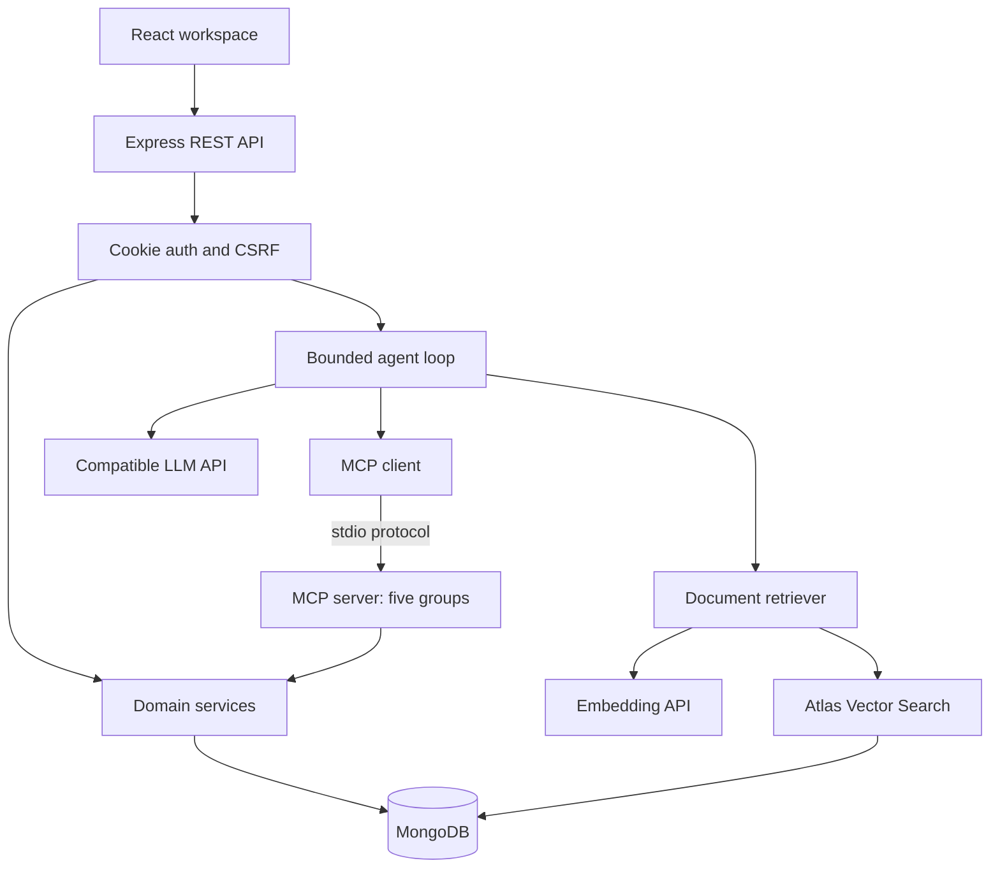

# CareerPilot AI

A React + Express scholarship and career workspace with real MongoDB persistence, an OpenAI-compatible agent, document RAG, and official MCP SDK tools. Built to be understandable in a student placement interview.

**Start here:** [QUICKSTART.md](QUICKSTART.md) · [PROJECT_WALKTHROUGH.md](PROJECT_WALKTHROUGH.md) · [INTERVIEW_PREP.md](INTERVIEW_PREP.md) · [Verification report](docs/VERIFICATION.md)

## What the application does

Register, build an academic/technical profile, explore scholarships and jobs, check eligibility, see skill gaps, upload a resume, track applications, and create in-app reminders. The assistant dynamically calls tools and retrieves document evidence. It cannot silently apply profile changes or create reminders: a separate confirmation card must be approved.

All supplied opportunities are clearly fictional **demo records**, with no invented official URLs. They are not active openings. No AI response is synthesized when a provider is disconnected.

## Implementation and verification status

| Area | Implementation | Verification |
|---|---|---|
| React dashboard and ten workspace views | Implemented | Production build and real-backend desktop/mobile browser checks pass |
| JWT auth, profile/skills/projects CRUD, tracker, reminders | Implemented against MongoDB | Real temporary MongoDB integration tests pass |
| Scholarship eligibility and skill matching | Deterministic rules | Unit tests pass |
| PDF/DOCX extraction and upload validation | Implemented | PDF/DOCX extraction, page limits and signature tests pass; sample fixtures included |
| MCP | One real SDK stdio server, five modular groups, 21 tools | SDK discovery, dispatch, authorization and real stdio + MongoDB integration tests pass |
| Agent | Function-calling loop, bounded calls/time, activity events, confirmation proposals | Loop behavior tested with explicitly injected model fixtures; live LLM not verified |
| RAG | Real embeddings, Atlas `$vectorSearch`, tenant filter, citations | Pipeline shape/isolation filter tested; actual Atlas retrieval requires credentials and index |
| Resume analysis/tailoring | Provider-backed JSON extraction and evidence-checked suggestions | No live LLM verification |
| Preparation plan | Deterministic four-week plan using actual gaps | Rule tests pass |
| Reminders | MongoDB records, due state shown in app | No email, push or background notification delivery |

This is an implementation ready for local setup and validation, **not a claim that externally dependent features were tested end to end**. Read `docs/VERIFICATION.md` before using resume claims.

## Stack

- Frontend: React, Vite, JavaScript, Tailwind CSS plus application styles, React Router, Axios, Lucide, react-markdown.
- Backend: Node.js 22+, Express 5, JavaScript ES modules, bcrypt, JWT, cookie-parser, Helmet, express-rate-limit, Zod, Multer.
- Persistence: Mongoose and MongoDB. Atlas Vector Search is needed for semantic retrieval.
- AI: native `fetch` to an OpenAI-compatible `/chat/completions` and `/embeddings` API. The model must support function calling and JSON object output.
- MCP: official `@modelcontextprotocol/sdk` v1 package as required by the brief. One process hosts five tool groups. No Express endpoint is relabeled as MCP.
- Parsing: pdf-parse, mammoth, adm-zip. Text-based files only; OCR is not included.
- Tests: Node's test runner, Supertest, mongodb-memory-server, Playwright (UI verification).

The SDK package is intentionally v1 to retain the brief's `@modelcontextprotocol/sdk` requirement; newer major SDK packaging can be migrated separately. Installed versions are recorded in `package-lock.json`.

## Architecture



### Frontend to backend

React uses Axios REST requests with credentials. The development Vite server proxies `/api` to Express on port 5000. Production Express serves the built frontend on the same origin. Chat uses `fetch` and server-sent events over a POST request for visible tool status updates; the final answer arrives as one message. This is activity streaming, not token-by-token generation.

### Authentication and authorization

- bcrypt cost 12 hashes passwords; database records do not contain plain-text passwords.
- JWTs last eight hours and use a fixed algorithm, issuer and audience. Cookies are HttpOnly, SameSite=Strict, and Secure in production.
- Each JWT includes a session version. Logout increments that version and invalidates existing session cookies for that user.
- All mutating API calls require an unpredictable double-submit CSRF value in a cookie and header. Origin validation also applies.
- All private queries are constrained by the authenticated user. Browser/LLM-supplied user IDs are never used to authorize access.
- The optional income is stored in the student's private profile. MCP profile reads omit it; eligibility tools return a redacted income result. A user can still voluntarily put financial information in chat or uploaded files; that text will reach their configured provider.
- Original upload bytes are processed in memory and discarded. Extracted resume text and private chunks remain in MongoDB until deleted.
- URLs are validated before storage/rendering, chat Markdown does not permit raw HTML, and secrets are not returned by settings endpoints.

## Local installation

Prerequisites: Node.js 22 or later and npm. Use MongoDB Atlas for the complete application. A local MongoDB instance can run CRUD, authentication and MCP, but does not replace Atlas Vector Search in this implementation.

```bash
cd careerpilot-ai
npm ci
cp backend/.env.example backend/.env
```

Windows PowerShell:

```powershell
Copy-Item backend/.env.example backend/.env
```

Generate your own JWT secret:

```bash
node -e "console.log(require('node:crypto').randomBytes(48).toString('hex'))"
```

Put it in `backend/.env`, and set `MONGODB_URI`. Do not paste secrets into frontend files or commit `.env`.

### Environment

| Variable | Purpose |
|---|---|
| `MONGODB_URI` | Atlas connection string with a database name; or local MongoDB for non-RAG features |
| `JWT_SECRET` | Random secret with at least 32 characters |
| `CLIENT_URL` | Exact browser origin; default `http://localhost:5173` |
| `PORT` | Express port; default 5000 |
| `NODE_ENV` | `development`, `test`, or `production` |
| `OPENAI_API_KEY` | Compatible provider key; backend only |
| `OPENAI_BASE_URL` | Provider API root; default `https://api.openai.com/v1` |
| `OPENAI_MODEL` | Your accessible model with tool/function calling and JSON mode |
| `EMBEDDING_MODEL` | Default `text-embedding-3-small`; set to a model your provider exposes |
| `EMBEDDING_DIMENSIONS` | Must match actual embedding output and the Atlas index; default 1536 |
| `VECTOR_INDEX` | Default `careerpilot_vector` |
| `RETRIEVAL_THRESHOLD` | Similarity cutoff, default 0.65; calibrate using your documents |
| `AI_TIMEOUT_MS` | Per-provider request timeout, default 45000 |
| `SEED_EMAIL` | Optional sample account email, default `demo@example.test` |
| `SEED_PASSWORD` | Required for seeding; choose at least 10 characters |

If using another compatible provider, both chat and embeddings must exist at the configured base URL. Some providers use different request parameters; the small adapter in `services/ai.js` is the intended customization point. No model capability is inferred from its name.

### Atlas setup

1. Create an Atlas cluster and database user with access to a database named `careerpilot`.
2. Allow your development machine's IP in Atlas network access. Use narrowly scoped access for deployment.
3. Copy the database connection string to `MONGODB_URI`, URL-encoding password characters as necessary. Include `/careerpilot` before query parameters.
4. Set the embedding model and matching dimensions.
5. Seed the ordinary records, then create the vector index:

```bash
npm run seed
npm run index:vector
```

6. In Atlas, wait until the index is ready. Its collection is `documentchunks`. The definition is also available in `docs/atlas-vector-index.json`.
7. Generate real embeddings for the provided demo documents:

```bash
npm run seed -w backend -- --with-embeddings
```

This makes actual paid/provider embedding calls for demo documents. The ordinary seed does not fake vectors or pretend document indexing succeeded. It creates 10 demo scholarships, 20 demo jobs, a fictional sample profile with skills/projects, five tracked applications, and writes 30 text documents under `demo-documents/`. Running it again does not duplicate those opportunities or overwrite an existing profile. Seed deadlines are fictional dates relative to the first run; existing deadlines are preserved.

### Start

```bash
npm run dev
```

Open **http://localhost:5173**. Create a real account or sign in with the demo email and password you configured. Sample profile/application records belong only to the seeded account. Scholarship/job records are shared discovery data.

MCP subprocesses start automatically when an agent run or confirmed action needs them and close afterwards. **Do not manually run `mcp/server.js` without a signed context**; refusing to start is its security behavior.

Separate terminals if preferred:

```bash
npm run dev -w backend
npm run dev -w frontend
```

Production, after setting `NODE_ENV=production` and `CLIENT_URL` to the exact HTTPS application origin:

```bash
npm ci
npm run build
npm start
```

A persistent Node-capable host is required: it must support spawning child processes for stdio MCP and connecting to Atlas. Static-only hosting or an edge Worker cannot run this backend unchanged. TLS, process supervision and deployment secrets are the host's responsibility. If operating behind a reverse proxy, configure Express `trust proxy` only for the actual trusted proxy topology before depending on per-IP limits. No public deployment is included.

## RAG explained

**Ingestion:** PDF/DOCX → signature/archive validation → text extraction (PDF page number when available) → cleanup → 1,600-character chunks with 250-character overlap → batches of real embeddings → MongoDB chunks plus metadata.

**Retrieval:** question → embedding → `$vectorSearch` → prefilter current user or public demo documents, plus embedding model and optional type → six results → relevance cutoff → tool response with quoted excerpts → grounded answer with source IDs.

Chunking is character-based, not token-based. File limits are 5 MB, 40 PDF pages and 80,000 extracted characters. Scanned/handwritten PDFs require prior OCR. DOCX page numbers are not stable, so they are left null. Atlas indexes update asynchronously: successful ingestion does not mean a new document is immediately searchable.

Embeddings encode semantic similarity as numeric vectors. Vector search can find conceptually related wording; keyword search primarily finds matching terms. Neither proves factual truth. Retrieval filters prevent cross-user candidate selection before search; a post-search filter alone is insufficient for tenant isolation. The model is instructed to treat excerpts as untrusted evidence, never commands. Only retrieved citation IDs are accepted. These safeguards reduce hallucination and injection risk; they are not a formal guarantee of answer correctness.

Switching embedding models/dimensions requires re-embedding documents and a compatible index. Model metadata prevents silently mixing incompatible embeddings. Index creation is explicit; the app never substitutes keyword lookup and calls it RAG.

## MCP and agent behavior

Five modules register 21 tools on one actual MCP server:

| Group | Tools |
|---|---|
| Profile | get_student_profile, get_student_skills, get_student_projects, update_student_profile |
| Scholarship | search_scholarships, get_scholarship_details, check_eligibility, get_required_documents, get_scholarship_deadline, track_scholarship_application |
| Jobs | search_jobs, get_job_details, check_job_match, track_job_application |
| Resume | get_resume, analyze_resume, compare_resume_with_job, generate_resume_suggestions |
| Calendar | list_upcoming_deadlines, create_reminder, list_reminders |

The API signs a short-lived MCP context tied to the authenticated student. The stdio server verifies it. Tool schemas never expose a `userId` parameter. The client discovers tools through `listTools`, maps their schemas to LLM functions, and invokes selected tools through `callTool`. RAG remains a separate agent function with a distinct knowledge-retrieval role.

The agent uses at most eight LLM steps and 18 tool calls, checks an approximately three-minute run budget between operations, and applies per-call provider/MCP timeouts. These checks are cooperative; a running operation can extend elapsed time until its own timeout.

**Mutations:** model proposes args → validated pending `ToolCall` saved with 15-minute expiry → user sees exact args → confirmation endpoint atomically claims the proposal → newly signed, short-lived capability grants only that tool+argument hash → MCP server executes once → result is stored. Free-text “yes” is not a capability. Failures are recorded, not silently retried. If a crash occurs after the database write but before confirmation completion, the record can remain `executing`; inspect persisted data before making another request. This is not a claim of distributed exactly-once delivery.

Tool events are activity messages, not hidden reasoning. Chats persist normal user/assistant messages; a limited recent window supplies short-term context. Profile, skills and projects are the long-term context. Credentials and unrestricted database errors are not included in user-facing error messages.

## Rules and matching

Scholarship checks support CGPA, optional income limit, degree, branch, deadline and an explicit completeness flag. Missing inputs or incomplete source rules produce **More information required**. Any failing rule produces **Not eligible**. Otherwise the result is **Eligible under the encoded rules**, not a provider's final award decision. These are limited rules: add explicit structured fields for domicile, citizenship, category and other requirements before calling real eligibility complete.

Job skill coverage = `(2 × required skills matched + preferred skills matched) / (2 × total required skills + total preferred skills) × 100`. Aliases are normalized and duplicate requirements removed. Beginner matches are labeled as partial. Relevant project technologies and resume keyword evidence are shown separately; they do not create hidden score points. The score is not a hiring probability and does not verify proficiency or experience.

Resume analysis uses real extracted text, validated JSON, exact original/evidence substring checks and an explicit prohibition on fabricated claims. Wording drafts still require human review; a matching quote alone cannot prove that every generated paraphrase preserves meaning. The application never auto-applies generated skills or rewrites and does not advertise an ATS score.

## REST API

All private routes require session cookies; every non-GET action also needs `X-CSRF-Token` from `GET /api/auth/csrf`.

| Route | Purpose |
|---|---|
| POST /api/auth/register, /login, /logout | Account/session lifecycle |
| GET /api/auth/me, /csrf | Session check and CSRF token |
| GET, PUT, DELETE /api/profile | Private profile lifecycle |
| GET, POST /api/skills; PUT, DELETE /api/skills/:id | Skill CRUD |
| GET, POST /api/projects; PUT, DELETE /api/projects/:id | Project CRUD |
| GET /api/scholarships; GET /api/scholarships/:id | Scholarship records and eligibility |
| GET /api/jobs; GET /api/jobs/:id; GET /api/jobs/:id/plan | Discovery, matching and learning plan |
| GET, POST /api/applications; PUT, DELETE /api/applications/:id | Tracker CRUD |
| GET /api/deadlines | Tracked upcoming deadlines |
| GET, POST /api/reminders; DELETE /api/reminders/:id | In-app reminders/dismissal |
| GET /api/documents; POST /api/documents/upload; DELETE /api/documents/:id | Private RAG documents |
| GET, DELETE /api/resume; POST /api/resume/upload; POST /api/resume/analyze | Resume workflow |
| GET, POST /api/chat/sessions | Conversation list/create |
| GET /api/chat/history?sessionId=... | Owned conversation history |
| POST /api/chat | Run agent; JSON or SSE response |
| GET /api/chat/pending; POST /api/chat/confirm/:id | Pending proposals and approve/decline |
| GET /api/dashboard, /api/settings | Dashboard aggregates/configuration flags |
| GET /health | Database connectivity, no private data |

Upload field name is `file`. Example reminder JSON: `{ "title": "Prepare transcript", "remindAt": "<future ISO timestamp>", "note": "Check required documents" }`. Confirmation body: `{ "approve": true }`. UI forms already construct valid payloads.

## Tests

```bash
npm run test:unit
npm run test:integration
npm test
npm run build
# Optional browser check after installing Chromium
npx playwright install chromium
npm run test:ui
```

`test:unit` does not require a running database. It checks domain logic, chunking, PDF/DOCX extraction, validation, agent control flow, vector query filters, and actual SDK discovery/dispatch/authorization using linked MCP transports. Injected test handlers/model responses are confined to tests.

`test:integration` starts a real temporary MongoDB process using mongodb-memory-server, downloads its binary on first run, and tests cookies/CSRF, actual persistence, tenant isolation, stdio MCP and confirmation execution. It does not connect to your production database. The test database disables Unix sockets and uses localhost TCP. If your environment prohibits `mongod`, run these tests on your laptop or CI rather than pretending a mock database passes them.

`test:ui` starts its own disposable MongoDB, backend and frontend, seeds fictional data, and tests browser flows with real REST calls. It needs free ports 5000/5173 and an installed Playwright Chromium. It never uses your production database or live AI key.

Live Atlas test (makes provider calls; creates and removes one disposable document):

```bash
# macOS/Linux
RUN_LIVE_TESTS=1 npm run test:live
```

```powershell
# Windows PowerShell
$env:RUN_LIVE_TESTS="1"
npm run test:live
```

Without `RUN_LIVE_TESTS=1`, the test is explicitly skipped. The live test requires a ready vector index and provider credentials. Complete the manual scenario in `docs/DEMO_CHECKLIST.md` for a genuine full demonstration.

## Import verified opportunities

No uncontrolled web scraping is included. An administrator should verify official provider/employer sources and insert reviewed records using Mongoose or an authenticated administrative import workflow you add later. Ordinary students cannot create public opportunity records.

Set `isDemo:false`, official `sourceUrl` and `applicationUrl`, `lastVerifiedAt` for scholarship checks, `retrievedAt` for job collection, accurate dates and all supported structured requirements. Keep `rulesComplete:false` when any important eligibility rule is not represented. Never extrapolate a current deadline from an older document. Uploaded private guidelines do not automatically rewrite the structured scholarship rules. Link an administrator-ingested public document to its opportunity using `opportunityId`; private user uploads remain private. If policy text and structured rules disagree, correct the source data before presenting eligibility as reliable.

## Troubleshooting

- **Database startup failed:** check URI/database name, Atlas IP access, database user permissions and network. Use the driver connection message locally; do not expose secrets in screenshots.
- **401:** sign in again; logout invalidates older tokens. **403:** refresh to obtain a new CSRF token; confirm `CLIENT_URL` exactly matches browser origin.
- **No AI:** set the key and model, then restart backend. A configured flag only reports settings presence, not provider availability.
- **Embedding dimension mismatch:** align the provider model, configured dimensions and index definition; re-index documents after changing models.
- **Vector search unavailable:** confirm Atlas index name, filter fields and ready state. Ordinary local MongoDB does not supply the Atlas feature here.
- **No citations:** seed with embeddings or upload/index relevant evidence; allow time for indexing; review threshold using the live test.
- **PDF unreadable:** use a text-based unencrypted document; scanned PDFs need external OCR.
- **MCP startup error:** verify Node executable and database connectivity. Stdout is reserved for protocol JSON; operational logs belong on stderr.
- **Reminder absent:** check approval status and expiry. Reminders do not trigger email/push notifications.
- **Server errors:** use server logs for a safe error class/status; never return raw API keys or database connection strings to clients.

## Limits and future work

Single Node instance by default; in-memory HTTP rate limits need a shared store for multi-instance deployment. One MCP subprocess per agent request is intentionally simple and trades memory/startup latency for isolation. Lists cap at 100 opportunities and 50 conversations; production pagination is future work. No scheduled web ingestion, OCR, external application submission, Google Calendar, email delivery, account recovery, email verification, admin console, ATS prediction, or proof of eligibility is included. Add retention/deletion policy, monitoring, quality evaluation, backup and real-user security review before public production use.

## Primary technical references

- Official MCP SDK v1 server documentation: https://ts.sdk.modelcontextprotocol.io/server
- Official MCP SDK repository: https://github.com/modelcontextprotocol/typescript-sdk
- Atlas vector query stage: https://www.mongodb.com/docs/atlas/atlas-vector-search/vector-search-stage/
- Mongoose: https://mongoosejs.com/docs/

The implementation uses the requested SDK v1 import paths, not examples from a differently packaged major version.
